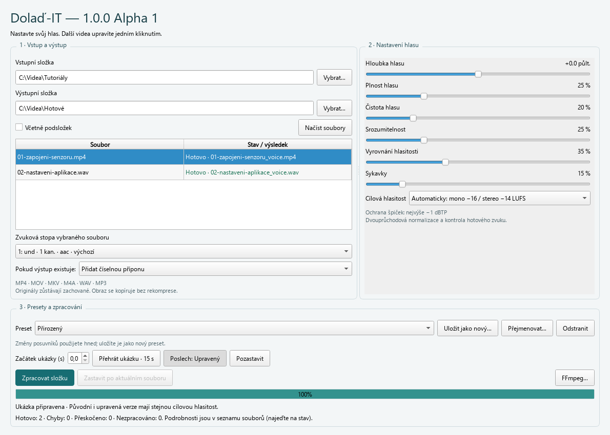

# Dolaď-IT

**Jednou nastavíš hlas. Další videa upravíš jedním kliknutím.**

Dolaď-IT je jednoduchá desktopová aplikace pro Windows 11 na úpravu mluveného
hlasu v technických tutoriálech a instruktážních videích. Vybereš složku,
použiješ svůj preset a aplikace postupně zpracuje všechny nahrávky.
Obraz videa se kopíruje bez nové komprese. Všechno běží lokálně a offline.

**Aktuální vydání: `v1.0` — 1.0.0 Alpha 1 (`1.0.0a1`).**
Jde o předběžnou verzi. Před první větší dávkou si poslechni ukázku.

[Stáhnout EXE pro Windows](https://github.com/barraka007-coder/Dolad-IT/releases/download/v1.0/Dolad-IT-Alpha.exe)
· [Vydání v1.0](https://github.com/barraka007-coder/Dolad-IT/releases/tag/v1.0)
· [Co obsahuje tato verze](docs/releases/v1.0.md)

*Skutečně vykreslené rozhraní nad zkušebními soubory. Zobrazené cesty jsou ukázkové.*

## Co umí v1.0

| Funkce | Co dělá |
|---|---|
| Hloubka hlasu | Jemná změna výšky od −2 do +2 půltónů, se zachováním formantů a tempa pomocí Rubber Band. |
| Plnost hlasu | Mírné přidání basů a úprava nižších středů. |
| Čistota hlasu | Nastavitelné potlačení stálého šumu pomocí FFT. |
| Srozumitelnost | Jemné zvýraznění frekvencí důležitých pro řeč. |
| Vyrovnání hlasitosti | Komprese hlasitějších pasáží s měkkým kolenem. |
| Sykavky | Nastavitelný de-essing. |
| Hlasitost výstupu | Dvouprůchodová normalizace: automaticky −16 LUFS mono / −14 LUFS stereo nebo pevný cíl. Kontrola špiček do −1 dBTP. |

Dále je k dispozici:

- **Presety** Přirozený, Hlubší a Dokumentární. Vlastní presety lze uložit,
  přejmenovat a odstranit; poslední nastavení se obnoví při dalším spuštění.
- **15sekundový náhled** od zvoleného času a přepínání Původní / Upravený.
  Obě ukázky mají přibližně stejnou vnímanou hlasitost.
- **Dávkové zpracování složky**, případně i podsložek, s průběhem a výsledkem
  u každého souboru. Chyba jednoho souboru nezastaví ostatní.
- **Zastavení po aktuálním souboru**, řešení kolizí názvů a bezpečné uložení
  hotového výstupu. Původní soubory se nepřepisují.
- **Více zvukových stop**: upraví se vybraná nebo jednoznačně výchozí stopa,
  ostatní se kopírují. Při nejasném výběru aplikace nabídne volbu.

## Podporované soubory

**MP4 · MOV · MKV · M4A · WAV · MP3**

U videa se používá `-c:v copy`: obraz se znovu nekomprimuje, nemění se jeho
rozlišení ani snímková frekvence. Pro MP4/MOV/MKV/M4A se upravený zvuk ukládá
jako AAC 192 kb/s mono nebo 256 kb/s stereo; WAV používá 24bit PCM a MP3 kodek MP3.

## Nejrychlejší spuštění

1. Z [vydání v1.0](https://github.com/barraka007-coder/Dolad-IT/releases/tag/v1.0)
   stáhni **`Dolad-IT-Alpha.exe`** (název přílohy na GitHubu je bez diakritiky).
2. Spusť EXE. Obsahuje Python, Qt, FFmpeg i FFprobe; nic dalšího se neinstaluje.
3. Vyber různé vstupní a výstupní složky.
4. Začni presetem **Přirozený**, načti soubory a poslechni si ukázku.
5. Dolaď hlas, ulož vlastní preset a stiskni **Zpracovat složku**.

Výstup dostane příponu názvu `_voice`. Při shodě názvů se podle volby přidá
číselná přípona, nebo se soubor přeskočí. Struktura podsložek zůstane zachovaná.
První start může chvíli trvat kvůli rozbalení knihoven.

Ve vydání je také `SHA256SUMS.txt` pro ověření staženého souboru.

## Spuštění ze zdrojů a vlastní EXE

Potřebuješ Windows 11, Python 3.11+ a FFmpeg/FFprobe ze stejné sestavy.

1. Stáhni nebo naklonuj repozitář.
2. Spusť **`Instalace.bat`**. První instalace stáhne Python knihovny.
3. Do **`tools\ffmpeg`** vlož `ffmpeg.exe` a `ffprobe.exe` z
   [rozcestníku FFmpeg pro Windows](https://ffmpeg.org/download.html#build-windows).
4. Spusť **`Spustit_DoladIT.bat`**.

Za běhu lze složku s FFmpeg vybrat také tlačítkem **FFmpeg…**, zpřístupnit ji
přes `PATH` nebo proměnnou `VOICE_STUDIO_FFMPEG`. Pro hloubku hlasu je potřeba
filtr `rubberband`, pro šum `afftdn` a pro sykavky `deesser`. Chybějící filtr
aplikace oznámí.

**`Vytvorit_EXE.bat`** vytvoří `release\Dolaď-IT-Alpha.exe` včetně obou
programů FFmpeg. Pracovní soubory sestavení se automaticky odstraní.
Zdrojové binárky FFmpeg, Python prostředí a hotové EXE nejsou součástí Gitu;
hotové EXE se distribuuje jako příloha vydání.

## Nastavení a soukromí

Presety a nastavení se ukládají do `%APPDATA%\VoiceStudio` jako UTF-8 JSON.
Tento název složky zůstává kvůli návaznosti na předchozí verze.
Ve stejné složce je lokální diagnostický log.

Aplikace nepotřebuje účet, cloud, placené API ani připojení k internetu.
Nahrávky a nastavení nikam neodesílá.

## Omezení alfy

- Zpracovává se **celá vybraná zvuková stopa**. Hudba a jiné zvuky smíchané
  s hlasem se upraví také; aplikace hlas automaticky neodděluje.
- Redukce šumu je určená pro stálý šum. Neodstraní spolehlivě ozvěnu,
  silný vítr nebo jiného mluvčího.
- Upravená stopa musí být mono nebo stereo. Prostorový zvuk se automaticky nepřevádí.
- U velmi krátké nahrávky nebo ticha nelze spolehlivě dosáhnout integrovaného LUFS cíle.
- Neobvyklé či poškozené kontejnery mohou skončit chybou. Podrobnosti jsou
  ve stavu souboru a v logu.

## Testy a dokumentace

Vydání pokrývá **28 automatických testů**: shoda video paketů bez rekomprese,
A/V časování, LUFS a špičky, presety, náhled, více stop, kolize i pokračování
dávky po chybě. Start sestaveného EXE se kontroluje zvlášť v dočasném profilu.

- **`Testy.bat`** spustí funkční testy a odstraní generovaná média.
- [Provedené ověření a tolerance](TESTOVANI.md)
- [Technické podrobnosti zpracování](docs/TECHNICKE_PODROBNOSTI.md)
- [Přehled změn](CHANGELOG.md)
- [Automatické sestavení vydání](.github/workflows/release-v1.yml)
- [Nahlásit chybu](https://github.com/barraka007-coder/Dolad-IT/issues)

Technologie: **Python · PySide6 / Qt · FFmpeg / FFprobe · Rubber Band**.
Při další distribuci je nutné respektovat licence těchto knihoven a konkrétní
sestavy FFmpeg.

Workflow **Windows Alpha v1.0** lze spustit ručně v GitHub Actions. Spouští se
také při commitu na `main` s označením `[release v1.0]`: ověří FFmpeg, provede
testy, sestaví a zkontroluje EXE a teprve potom vytvoří tag a předběžné vydání.
