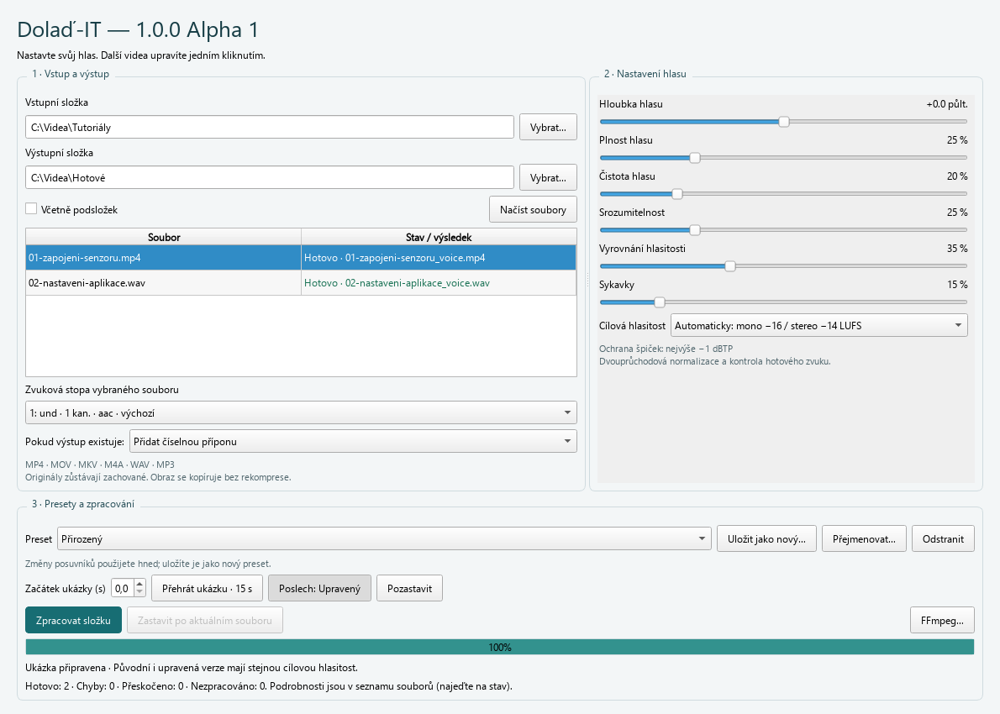

# Dolaď-IT v1.0 — 1.0.0 Alpha 1

První označené vydání lokální aplikace na automatickou úpravu mluveného
hlasu v tutoriálech. Nastav si hlas, ulož preset a další videa zpracuj dávkově.

**Tag:** `v1.0` · **Verze aplikace:** `1.0.0a1` · **Stav:** Alpha · **Systém:** Windows 11

## Hlavní funkce

- Hloubka ±2 půltóny se zachováním formantů, plnost, srozumitelnost,
  redukce stálého šumu, komprese a potlačení sykavek.
- Automatický cíl −16 LUFS mono / −14 LUFS stereo, pevné cíle a špičky do −1 dBTP.
- Patnáctisekundový A/B náhled s obdobnou vnímanou hlasitostí.
- Presety Přirozený, Hlubší, Dokumentární a vlastní uložená nastavení.
- Dávka MP4, MOV, MKV, M4A, WAV a MP3 včetně podsložek, stavů souborů
  a zastavení po aktuálním souboru.
- Obraz se kopíruje pomocí `-c:v copy`, originály se nepřepisují.

## Stažení a spuštění

Stáhni **`Dolad-IT-Alpha.exe`** z příloh tohoto vydání a spusť ho.
Python, Qt, FFmpeg i FFprobe jsou přibalené. Za běhu není potřeba internet.
Přiložený `SHA256SUMS.txt` slouží k ověření staženého EXE.

Vyber různé vstupní a výstupní složky, použij preset **Přirozený**, poslechni
si ukázku a potom spusť zpracování. První start může chvíli rozbalovat knihovny.

## Ověření

28 funkčních testů pokrývá kopii komprimovaných video paketů, časování A/V,
normalizaci a špičky, presety, náhled i chybové stavy dávky. Samostatná kontrola
ověřuje příznak Alpha a start EXE s přibaleným FFmpeg v odděleném profilu.
Konkrétní tolerance jsou uvedené v `TESTOVANI.md`.

## Známá omezení

Jde o předběžnou verzi. Před větší dávkou si poslechni ukázku svého hlasu.
Upravuje se celá vybraná stopa včetně případné hudby. FFT redukce šumu
nenahrazuje oddělení mluvčího ani odstranění ozvěny. Podporovaný upravovaný
zvuk je mono nebo stereo. U ticha a velmi krátkých klipů nelze spolehlivě
dosáhnout integrovaného LUFS cíle.

